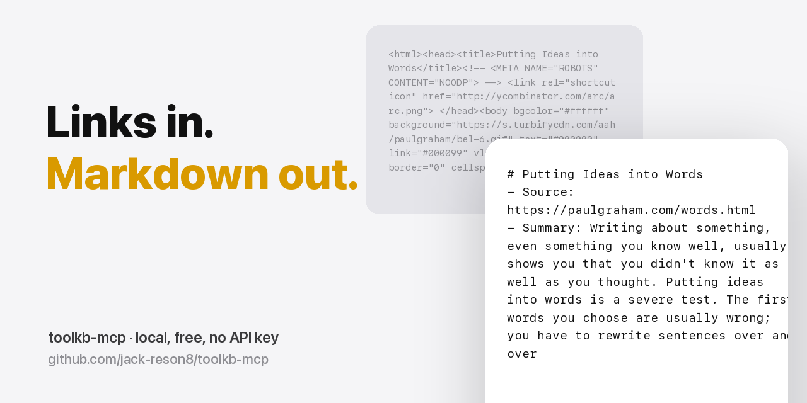

# toolkb-mcp

<p align="center"></p>
<p align="center"><sub>Part of <a href="https://github.com/jack-reson8/copy-that"><b>Copy That</b></a> · install the whole set in one line</sub></p>

**Turn any link into clean, AI-ready Markdown – right inside Claude Code, Codex, Cursor or any MCP client.**
Local, free, open source. No API key, no account, nothing sent to a third-party service.

| Tool | What you get |
|---|---|
| `youtube_transcript` | Full transcript of a YouTube video (watch, youtu.be, shorts, live) with title, channel, duration and clickable `[mm:ss]` timestamps. Uploaded or auto-generated captions, any caption language. |
| `youtube_playlist` | Every video of a playlist or channel (`/@handle`) with titles, lengths and links – or, with `transcripts: true`, their transcripts in one Markdown document: an instant knowledge base. Sized to fit Claude Code's tool output limit. |
| `webpage_to_markdown` | The main content of an article, blog post or docs page as Markdown – no menus, ads or scripts. Absolute links and images. |
| `app_store_reviews` | Up to 500 recent App Store reviews of any iOS/macOS app with a rating histogram – ready for "what do users hate about this app?" |

## Install

**Claude Code**

```bash
claude mcp add toolkb -- npx -y github:jack-reson8/toolkb-mcp
```

**Codex** – add to `~/.codex/config.toml`:

```toml
[mcp_servers.toolkb]
command = "npx"
args = ["-y", "github:jack-reson8/toolkb-mcp"]
```

**Cursor / Claude Desktop / others** – add to your MCP config:

```json
{ "mcpServers": { "toolkb": { "command": "npx", "args": ["-y", "github:jack-reson8/toolkb-mcp"] } } }
```

Requires Node.js 18+. Behind a proxy? `HTTPS_PROXY` / `HTTP_PROXY` / `NO_PROXY` are respected automatically.

## Try it

Ask your assistant things like:

- "Get the transcript of https://youtu.be/zjkBMFhNj_g and turn it into study notes with timestamps."
- "Get the transcripts of the first 5 videos in this playlist and build me a study guide."
- "List every video on @AndrejKarpathy and tell me which ones cover tokenization."
- "Read https://www.paulgraham.com/greatwork.html and summarise the 10 key ideas."
- "Pull the last 300 one- and two-star reviews of app 1232780281 and group the complaints by theme with counts."

## CLI

The same tools work from a terminal:

```bash
npx -y -p github:jack-reson8/toolkb-mcp toolkb yt https://youtu.be/jNQXAC9IVRw
npx -y -p github:jack-reson8/toolkb-mcp toolkb playlist https://www.youtube.com/@AndrejKarpathy --transcripts 5
npx -y -p github:jack-reson8/toolkb-mcp toolkb web https://example.com/article
npx -y -p github:jack-reson8/toolkb-mcp toolkb reviews 1232780281 --pages 5 --max 2
```

## Notes

- Transcripts come from the captions YouTube already shows to viewers; videos without captions have no transcript. Video and audio are never downloaded.
- Web pages are fetched once, like a browser would. Please respect each site's terms.
- App Store reviews use Apple's public customer-reviews feed (max 10 pages × 50 reviews per country).

Made by [ToolKB](https://jack-reson8.github.io/) – professional file tools, pay per job.
MIT licensed.
